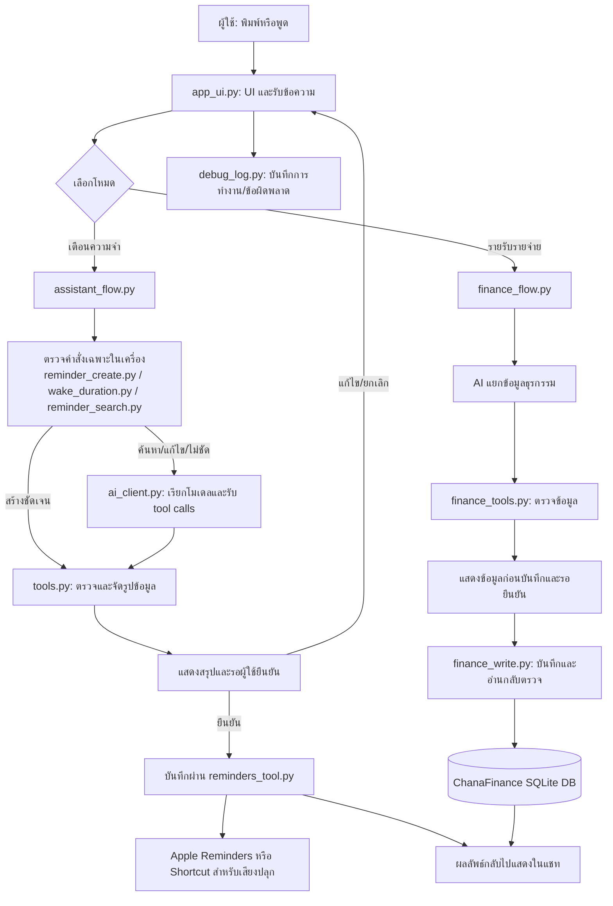

# Handoff v21 — แก้ flow สร้างคำเตือนและบันทึกภาพรวมระบบ

## เป้าหมายของงานรอบถัดไป

ทำให้คำสั่งสร้างการเตือนที่วัน/เวลา/งานครบถูกจัดเป็นคำสั่งสร้างรายการทันที และถ้าข้อมูลขาดหรือกำกวม ให้แอปถามทีละข้อ จากนั้นแสดงสรุปให้ผู้ใช้ยืนยันก่อนบันทึก ห้ามส่งคำสั่งสร้างการเตือนที่ชัดเจนไปเข้าทางค้นหารายการเตือน

## สถานะล่าสุด

- ผู้ใช้ใช้งานแอปผ่าน Pythonista จาก **External Files → On My iPhone** ไม่ได้รันจาก sandbox โฟลเดอร์ `secretary_ai` ใน Pythonista
- Handoff ก่อนหน้าคือ `handoff_v20.md` ซึ่งบันทึกการถามวันที่ล่วงหน้าในโหมดรายรับรายจ่าย
- ไฟล์บน Mac ที่ได้รับตรวจมี `app_ui.py` เรียก `reminder_create.parse_request(text)` ก่อนเข้าเส้นทางค้นหา/AI และ import `wake_duration.py`
- `reminder_create.py` ปัจจุบันรองรับ intent บางรูปแบบ เช่น “ใช้ข้อความเตือนว่า … พรุ่งนี้เวลาเที่ยง” และเวลาแบบ “อีก 30 นาที” โดยตั้ง `urgent_alarm=False`
- แต่ผลบน iPhone ยังไม่ตรง: คำสั่ง “วันพรุ่งนี้เวลาเที่ยงช่วยเตือนฉันว่าไปกินข้าว” กลับได้คำตอบว่าไม่มีรายการเตือน แทนการสร้างรายการ
- คำสั่ง “ตั้งปลุกหลังจากนี้ 30 นาที ใช้ข้อความว่าเต็มว่า กินข้าวได้แล้ว” กลับถูก AI ถามว่าให้ปลุกกี่โมง ทั้งที่มีช่วงเวลาแล้ว
- `debug 6.log` มีบรรทัดจบ action เวลา 19:38 แต่ไม่มี marker `build=v24` และไม่มี `reminder_create matched=...` จึงยังไม่ทราบแน่ชัดว่า Pythonista โหลด `app_ui_v24.py` หรือ `reminder_create.py` จากตำแหน่งใด หรือกำลังใช้ process ที่เปิดค้างอยู่
- มีไฟล์ตรวจสอบใน `outputs/app_ui_v24.py` เพิ่ม log สำหรับบันทึก `__file__` ของ app/module และผลการจับ intent; ยังไม่ได้ยืนยันการรันไฟล์นี้บน iPhone

## ขั้นตอนต่อไปสำหรับผู้ช่วย

1. ให้ผู้ใช้ใช้ `outputs/app_ui_v24.py` แทนชื่อ `app_ui.py` ในโฟลเดอร์ External Files ที่เปิดใช้งานจริง โดยให้ `reminder_create.py` และ `wake_duration.py` อยู่โฟลเดอร์เดียวกัน
2. ปิด Pythonista ให้สนิทแล้วเปิดไฟล์จาก External Files ใหม่ เพื่อไม่ใช้โมดูลที่ค้างในหน่วยความจำ
3. ทดสอบเฉพาะเหตุการณ์แรก: `วันพรุ่งนี้เวลาเที่ยงช่วยเตือนฉันว่าไปกินข้าว`
4. อ่าน `debug.log` รอบใหม่:
   - ถ้าไม่มี `build=v24` แสดงว่ายังไม่ได้รันไฟล์ `app_ui_v24.py` ที่เตรียมไว้ หรือ log มาจากคนละตำแหน่ง
   - ถ้ามี `build=v24` แต่ไม่มี `reminder_create matched=True` ให้แก้ parser ให้รับรูปประโยคจริง
   - ถ้ามี `matched=True` แต่ยังไม่เห็นหน้าสรุปยืนยัน ให้ไล่ต่อจาก `prepare_actions` และ action flow
5. เมื่อเหตุการณ์แรกทำงานแล้ว จึงทดสอบ “อีก 30 นาที” เป็นกรณีถัดไป ไม่ควรรวมหลายอาการในรอบเดียว
6. หลังยืนยันเส้นทางรันจริงแล้ว ค่อยทำ guided flow: ถ้า intent ชัดและข้อมูลครบ ให้ไปหน้าสรุปยืนยัน; ถ้าขาดข้อมูล ให้ถามเฉพาะช่องที่ขาดทีละข้อ (งาน → วัน → เวลา) และถามเรื่องเสียงปลุกเฉพาะเมื่อเจตนาไม่ชัด

## ข้อกำหนดการทำงานของการเตือน

- “เตือน” ที่มีงานและวันเวลาแน่ชัด: สร้าง Reminder ปกติและแสดงข้อมูลก่อนบันทึก
- “ปลุก” หรือผู้ใช้ระบุชัดว่าต้องการเสียงปลุก: ส่ง `urgent_alarm=True` ตาม flow เดิม
- ข้อความที่กำหนดเฉพาะงานหรือเวลาไม่ครบ: อย่าเดา ให้ถามข้อมูลที่ขาดทีละข้อและเก็บคำตอบต่อเนื่องจนข้อมูลครบ
- ก่อนสร้าง/บันทึก ให้ผู้ใช้ตรวจชื่อรายการ วัน เวลา และชนิดการเตือนในหน้าสรุป
- เมื่อข้อความเป็นคำสั่งสร้าง ห้ามส่งไป `list_reminders`/`search_reminders` เพียงเพราะมีวันที่หรือเวลาอยู่ในประโยค
- แยกคำสั่งค้นหารายการจริง เช่น “มีรายการเตือนอะไรพรุ่งนี้” ออกจากคำสั่งสร้าง เช่น “พรุ่งนี้เที่ยงช่วยเตือนฉันว่าไปกินข้าว”

## ภาพรวมสถาปัตยกรรมและการไหลของข้อมูล

รายละเอียดที่ยังไม่ยืนยันจากข้อมูลที่มี: ตำแหน่งและไฟล์ที่ Pythonista บน iPhone โหลดจริง, ข้อความ `__file__` ของ module ใน runtime, และว่า Shortcut/การแจ้งเตือนบน iPhone จะทำงานอย่างไรในแต่ละสถานะของ iOS ต้องตรวจจาก log และทดสอบบนอุปกรณ์ ไม่ควรคาดเดา

## Prompt สำหรับสร้าง/ปรับปรุงแผนภาพใน handoff รุ่นถัดไป

ให้วิเคราะห์ไฟล์จริงของโปรเจกต์ `secretary_Ai` แล้วสร้างหรือปรับปรุงแผนภาพที่อธิบายภาพรวมระบบให้อ่านง่าย แสดงส่วนประกอบหลัก ความสัมพันธ์ และลำดับข้อมูลตั้งแต่ผู้ใช้เริ่มส่งคำสั่งจนได้รับผลลัพธ์ แยกเส้นทางเตือนความจำกับรายรับรายจ่ายให้เห็นชัด ใช้ Mermaid ใน handoff หากเหมาะสม และระบุ “ไม่ทราบ” ในจุดที่ไม่มีหลักฐานจากโค้ดหรือ log ห้ามอนุมานรายละเอียดที่ยังไม่ยืนยัน เก็บแผนภาพนี้ไว้ใน handoff รุ่นใหม่ทุกครั้งที่สร้าง handoff

## ไฟล์ที่เกี่ยวข้อง

- `app_ui.py`: route โหมดและเริ่มงาน
- `assistant_flow.py`: เครื่องมือเตือนความจำและลำดับยืนยัน/บันทึก
- `reminder_create.py`: จับคำสั่งสร้างเตือนก่อนส่งให้ AI
- `wake_duration.py`: จับช่วงเวลาแบบสัมพัทธ์สำหรับปลุก
- `reminder_search.py`: ค้นหารายการเตือน
- `tools.py`: schema และตรวจข้อมูล tool call
- `reminders_tool.py`: เชื่อม Apple Reminders/Shortcut
- `finance_flow.py`, `finance_tools.py`, `finance_write.py`: เส้นทางการเงิน (รายละเอียดตาม handoff v20)
- `debug_log.py`: เขียน log ข้างไฟล์ module ที่โหลดอยู่

## สถานะการทดสอบและข้อควรระวัง

- ยังไม่มีหลักฐานว่ารุ่น v24 ถูกโหลดและทดสอบบน iPhone
- ยังไม่ควรแก้ parser เพิ่มโดยไม่มี log ระบุว่า runtime จับ intent ได้หรือไม่ เพราะโค้ดบน Mac มี hook อยู่แล้ว แต่ผลจากอุปกรณ์ไม่ตรงกับ hook นั้น
- ผู้ใช้ขอทำทีละกรณี ให้แก้และตรวจกรณี “พรุ่งนี้เที่ยงช่วยเตือนฉันว่าไปกินข้าว” ก่อน แล้วค่อยไปกรณี 30 นาที
- ห้ามถือว่าไฟล์ใน Pythonista sandbox เป็น runtime; ผู้ใช้รัน External Files → On My iPhone
