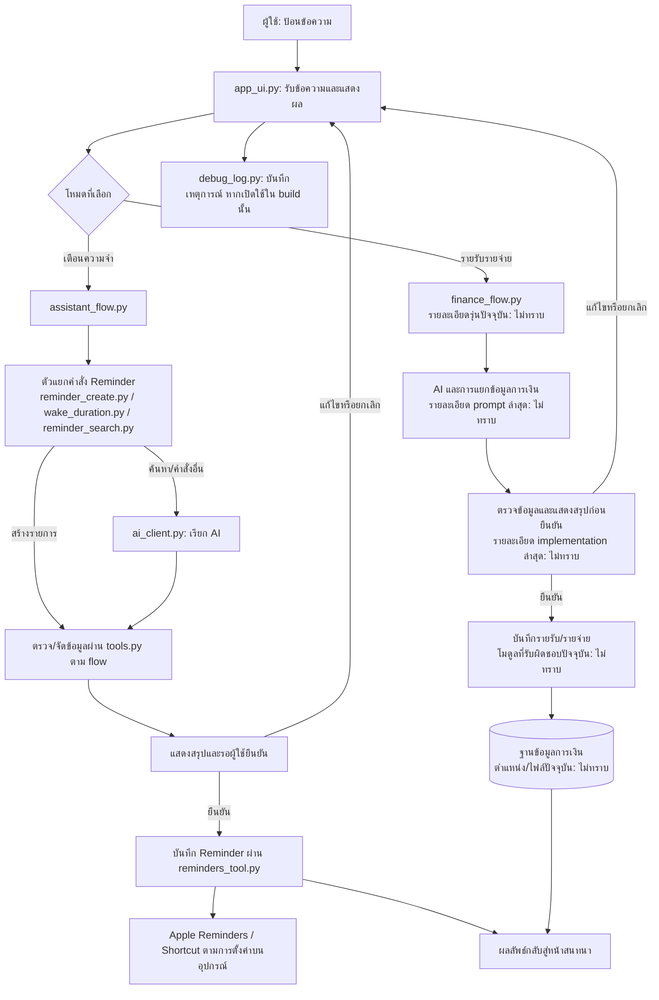

# Handoff v23 — ปิดงานเตือนความจำชั่วคราว และเตรียมแก้ prompt รายรับรายจ่าย

## เป้าหมายรอบถัดไป

ตรวจและแก้ prompt/การแปลคำสั่งในโหมดรายรับรายจ่ายที่ผู้ใช้พบว่าทำงานผิด โดยเริ่มจากตัวอย่างจริงทีละกรณี เปรียบเทียบข้อความที่ส่ง ผลที่ได้ และผลที่ต้องการ ก่อนแก้โค้ด

## สถานะปัจจุบัน

- ผู้ใช้แจ้งว่าเรื่อง Reminder “ค่อนข้างจะ OK” และยืนยันหลังแก้ syntax ว่า “ได้แล้ว” จึงพักงาน Reminder ไว้ก่อน หากมีปัญหาใหม่ค่อยกลับมาแก้
- อาการล่าสุดเกิดจากข้อความจริง `ช่วยเตือนฉันวันนี้ตอนสี่ทุ่มครึ่งว่าสถานะช้อปปี้เป็นอย่างไร` ซึ่งวางวันเวลาไว้หลัง “ฉัน” และไม่ได้ใช้รูปประโยคที่ parser รุ่นก่อนรองรับ
- การแก้ parser รุ่น v31 มีวงเล็บใน regular expression ไม่ครบ ทำให้ Pythonista แจ้ง `missing ), unterminated subpattern`; รุ่น v32 แก้ syntax ดังกล่าว และผู้ใช้แจ้งว่าใช้ได้แล้ว
- อย่าสรุปว่า Reminder ผ่านการทดสอบครบทุกกรณี: ยืนยันได้เพียงว่าปัญหา syntax ล่าสุดหายและผู้ใช้เห็นว่าใช้งานได้ในระดับที่พอใจ ส่วนการทดสอบ end-to-end สำหรับรูปประโยคอื่นยังไม่ทราบ
- ผู้ใช้แจ้งว่าขั้นต่อไปคือแก้ส่วนรายรับ/รายจ่าย เพราะมีบาง prompt ที่ AI ทำงานผิด แต่ยังไม่ได้ระบุตัวอย่างปัญหาในรอบใหม่นี้

## สำคัญก่อนแก้โค้ด

- ผู้ใช้ย้ำว่าไฟล์บางไฟล์ถูกแก้ไปแล้ว หากจะทำไฟล์ใหม่ต้องให้ผู้ใช้ส่งไฟล์ล่าสุดก่อน ห้ามใช้สำเนาเก่าใน `outputs/` หรือ handoff ก่อนหน้าแทนไฟล์ที่กำลังใช้งาน
- ก่อนแก้รายรับรายจ่าย ให้ขอไฟล์ล่าสุดที่เกี่ยวข้อง (อย่างน้อย `app_ui.py`, `finance_flow.py`, `assistant_flow.py`, `ai_client.py` และ `modes.py` หากยังเกี่ยวข้องกับเส้นทางนั้น) พร้อมข้อความ prompt ที่ทำให้เกิดปัญหา
- ขอข้อมูลต่อกรณี: ข้อความที่พิมพ์/พูดจริง, ผลที่ AI แสดงหรือบันทึก, ผลที่ผู้ใช้คาดหวัง และภาพหน้าจอหรือ log ถ้ามี ทำทีละกรณีตามที่ผู้ใช้ต้องการ
- อย่าสร้างไฟล์ทดแทนจากไฟล์เก่า และอย่าเขียนทับไฟล์ต้นฉบับที่ผู้ใช้ยังไม่ได้ส่งรุ่นล่าสุด

## วิธีรันและตำแหน่งไฟล์

- ผู้ใช้รันแอปบน iPhone ผ่าน Pythonista โดยเปิด **External Files → On My iPhone**
- ผู้ใช้ยืนยันว่าใน Pythonista sandbox ไม่มีโฟลเดอร์ `secretary_ai`; อย่าแนะนำให้คัดลอกหรือรันจาก sandbox นั้น
- ในการทดสอบ log รุ่นก่อนแสดง runtime ใต้ `.../Documents/secretary_ai/` ของ Pythonista แต่ต้องตรวจ path จาก log ของรอบปัจจุบันทุกครั้ง ไม่ควรถือว่า path หรือไฟล์ที่โหลดเหมือนเดิม
- การนำไฟล์ไปใช้ต้องคงชื่อโมดูลจริงตามที่แอป import เช่น `app_ui.py` และ `reminder_create.py`; ไฟล์ที่มี suffix รุ่นใช้เป็นสำเนาอ้างอิง ไม่ใช่ชื่อที่แอปจะโหลดโดยอัตโนมัติ

## ประวัติรายรับรายจ่ายที่ยืนยันแล้ว

- ก่อนหน้านี้ผู้ใช้รายงานว่าการบันทึกรายจ่ายและรายรับกลับมาใช้งานได้ และรายรับใช้งานได้
- หมวด “ค่าเช่าบ้าน” ไม่พบในตอนแรก ผู้ใช้เพิ่มหมวดนี้ในฐานข้อมูลแล้วและยืนยันว่าเมื่อมีหมวด ระบบทำงานถูกต้อง
- เคยมีปัญหาวิธีชำระเงินด้วยบัตรเครดิตไม่ปรากฏในหน้าสรุป และปุ่มยืนยันทำให้แอปเด้งออก; ภายหลังแก้แล้ว ผู้ใช้ยืนยันว่าใช้งานได้และไม่เด้ง
- เคยปรับให้แอปถามวันที่ก่อนเรียก AI ใน flow รายรับ/รายจ่ายเมื่อไม่มีวันที่ ผู้ใช้ยืนยันว่าใช้ได้
- งานรอบใหม่คือ prompt บางแบบยังถูกตีความผิด รายละเอียดตัวอย่างยังรอผู้ใช้ส่ง

## สถานะไฟล์อ้างอิงในชุดนี้

ไฟล์ใน `outputs/` เป็นสำเนาที่แนบ/สร้างระหว่างการแก้ก่อนหน้า และอาจไม่ตรงกับรุ่นบน iPhone ปัจจุบัน:

- `outputs/app_ui_v31.py`, `outputs/assistant_flow_v31.py`, `outputs/reminder_create_v32.py` เป็นสำเนารุ่นล่าสุดที่เห็นในชุดนี้สำหรับงานเตือน
- `outputs/reminder_create_v31.py` เป็นสำเนาที่มี syntax error; อย่านำไปติดตั้ง
- สำเนาอื่นที่มีเลขรุ่นและไฟล์ probe/debug ใช้เพื่ออ้างอิงหรือวินิจฉัยเท่านั้น ไม่ใช่หลักฐานว่าเป็นไฟล์ที่ติดตั้งอยู่
- รุ่นที่อุปกรณ์โหลดจริงใน log เก่าบางรอบยังเป็น `app_ui v30`, `assistant_flow v29`, `reminder_create v30`; หลังจากนั้นผู้ใช้ติดตั้งรุ่นแก้ syntax และแจ้งว่าได้แล้ว แต่ไม่มี log ยืนยัน build ล่าสุด จึงไม่ทราบหมายเลข build ปัจจุบันบนเครื่อง

## แนวทางวินิจฉัย prompt รายรับรายจ่าย

1. รับตัวอย่าง prompt จริงหนึ่งข้อความ พร้อมผลที่เกิดขึ้นและผลที่ต้องการ
2. ตรวจไฟล์ล่าสุดจากผู้ใช้และไล่เส้นทางข้อความตั้งแต่ UI, โหมด, prompt/AI call, parsing/validation, หน้ายืนยัน จนถึงการบันทึก
3. แยกให้ชัดว่าความผิดอยู่ที่การเลือกโหมด, prompt, การ parse คำตอบ, การถามข้อมูลที่ขาด, การแสดงสรุป หรือการบันทึก
4. แก้เฉพาะสาเหตุที่พิสูจน์ได้และรักษาพฤติกรรมที่ผู้ใช้ยืนยันว่าใช้งานได้
5. ไม่เพิ่มหรือรันชุดทดสอบเอง เว้นแต่ผู้ใช้ขอให้ทดสอบ/ตรวจสอบ; หากต้องให้ผู้ใช้ลองบน iPhone ให้ระบุไฟล์ที่ต้องแทนและคำสั่งตัวอย่างเพียงกรณีเดียว พร้อมสิ่งที่ควรเห็น

## แผนภาพภาพรวมและการไหลของข้อมูล

แผนภาพนี้คงส่วนประกอบที่ปรากฏใน handoff และไฟล์อ้างอิงก่อนหน้าไว้ จุดเชื่อมต่อการเงินบางส่วนยังต้องตรวจจากไฟล์รุ่นล่าสุดก่อนยืนยันรายละเอียด

## Prompt สำหรับสร้างหรือปรับปรุงแผนภาพใน handoff รุ่นต่อไป

> วิเคราะห์ไฟล์รุ่นล่าสุดของโปรเจกต์ `secretary_Ai` ที่ผู้ใช้ส่งหรือยืนยันว่าใช้งานอยู่ แล้วสร้างหรือปรับแผนภาพภาพรวมระบบให้อ่านง่าย แสดงส่วนประกอบหลัก ความสัมพันธ์ และลำดับข้อมูลตั้งแต่ผู้ใช้เริ่มส่งคำสั่งจนได้รับผลลัพธ์ แยกเส้นทางเตือนความจำและรายรับรายจ่ายให้ชัด ใช้ Mermaid ใน handoff หากเหมาะสม ตรวจชื่อโมดูลและจุดเชื่อมต่อจากโค้ดจริง อย่านำชื่อไฟล์จาก handoff เก่ามายืนยันแทนหลักฐาน หากไม่มีข้อมูลชัดเจนให้เขียน “ไม่ทราบ” แทนการคาดเดา และคงทั้งแผนภาพกับ prompt นี้ไว้ใน handoff รุ่นถัดไป

## สิ่งที่ผู้ช่วยรอบถัดไปควรทำก่อน

เริ่มด้วยการขอ prompt รายรับ/รายจ่ายที่ทำงานผิดหนึ่งตัวอย่าง พร้อมผลที่เกิดขึ้นและผลที่ต้องการ และขอไฟล์ล่าสุดที่เกี่ยวข้องจากผู้ใช้ก่อนเริ่มแก้โค้ด
