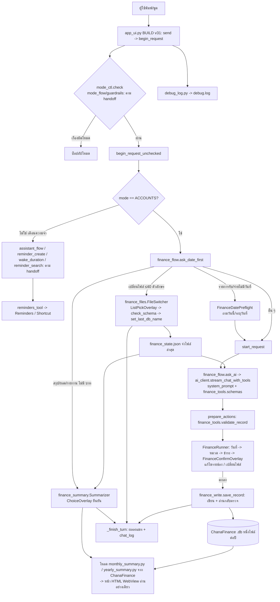

# Handoff v24 — AI เลขาส่วนตัว (Pythonista 3 / iPhone) — เพิ่ม "เปลี่ยนไฟล์" และ "สรุปยอดรายเดือน/รายปี"
วันที่ 14 ต.ค. 2026 — อ่านคู่กับ handoff_v23.md (ภาพรวม/ข้อตกลง/สคีมา ChanaFinance อยู่ใน v18, เรื่อง Reminder ดู v14/v23)
ผู้ใช้: Chana — ตอบไทย กระชับ ทดสอบบน iPhone เอง เครดิตจำกัด ทำทีละเรื่อง ยืนยันความเข้าใจก่อนเขียนโค้ด แก้เฉพาะจุด

## 1. กติกาทำงาน (ยืนยันซ้ำ)
- ส่งไฟล์ฉบับเต็ม บอกว่าแก้ตรงไหน **บอกให้วางไฟล์ครบทุกไฟล์ที่ส่ง** แล้วปิด Pythonista สนิทก่อนเปิดใหม่
- `app_ui.py` / `assistant_flow.py` ยาวมากแล้ว ห้ามเพิ่ม: งานโหมดบัญชีแยกเป็น `finance_*.py`; ก่อนแก้ไฟล์เดิมต้องมีไฟล์ล่าสุดจากผู้ใช้ (ไม่ใช้สำเนาเก่า)
- callback เป็น bound method + `ui.delay(เมธอด, 0.3)`; ห้าม closure/lambda; ป๊อปอัปปิดตัวเองก่อนเรียก callback
- ไม่เพิ่ม/รันชุดทดสอบเองเว้นแต่ผู้ใช้ขอ; ผู้ช่วยไม่ได้ทดสอบบน iPhone จริง ต้องบอกผู้ใช้ตรง ๆ
- ทดสอบการเขียนฐานข้อมูลกับ **สำเนา .db** เท่านั้น

## 2. สถานะ
- Reminder: พักไว้ (ผู้ใช้พอใจระดับหนึ่ง ดู v23); โหมดรายรับรายจ่าย: บันทึก/แก้ไข/ถามวันที่ ใช้งานได้ (ดู v23)
- **เปลี่ยนไฟล์ (finance_files.py): ผู้ใช้ทดสอบบนเครื่องแล้ว "เปลี่ยนไฟล์ได้แล้ว"**
- **สรุปยอดรายเดือน/รายปี (finance_summary.py): ส่งแล้ว ยังไม่ได้ทดสอบบนเครื่อง** (ผู้ใช้เพิ่งรับไฟล์)
- ผู้ใช้เคยบอกว่ามี prompt ในโหมดรายรับรายจ่ายที่ AI ทำผิด **ยังไม่ได้ส่งตัวอย่าง** — รอเจอกรณีจริงแล้วแก้ทีละกรณี (ขั้นตอนใน v23)
- เฟส 3 (หลักทรัพย์): ผู้ใช้สั่งให้เลื่อน ยังไม่เริ่ม

## 3. ไฟล์ที่เพิ่ม/แก้ในรอบนี้ (ต้องวางครบ)
| ไฟล์ | สถานะ |
|---|---|
| `finance_files.py` (ใหม่) | คำสั่งเปลี่ยนไฟล์ ✔ ทดสอบแล้ว |
| `finance_summary.py` (ใหม่) | คำสั่งสรุปยอด ยังไม่ทดสอบ |
| `finance_flow.py` (แก้) | `import finance_files, finance_summary` และใน `ask_date_first` เพิ่มการตรวจ 2 คำสั่งนี้ **ก่อน** ตัวตรวจ "รายการรับ/จ่ายไม่มีวันที่" |
`app_ui.py` (BUILD v31) **ไม่ได้แก้** — มันเรียก `finance_flow.ask_date_first(self, text)` อยู่แล้ว ถ้าคืน True = จบ (ไม่เรียก AI) ทั้งสองคำสั่งจึงสร้างรอบแชทเองด้วย `host._live` + `host._finish_turn(msg,'ok',tool=True)` แล้ว `host.input.text=''`

## 4. พฤติกรรมที่ทำ
**เปลี่ยนไฟล์** (`finance_files.is_switch_request`): ข้อความ ≤40 ตัวอักษร มีคำ เปลี่ยนไฟล์/สลับไฟล์/เลือกไฟล์/ใช้ไฟล์อื่น/ไฟล์อื่น -> ListPickOverlay รายชื่อ .db ทั้งโฟลเดอร์ (ไฟล์ที่ใช้อยู่มี "(ใช้อยู่)") ไม่ถามชื่อไฟล์ ไม่เรียก AI -> เลือกแล้ว `check_schema` (ล็อก/โครงสร้างไม่ครบ = ไม่เปลี่ยนและแจ้ง) -> `fdb.set_last_db_name` -> "เปลี่ยนไฟล์เป็น X แล้ว ✓"; เลือกไฟล์เดิม/ยกเลิก = แจ้งว่าไม่เปลี่ยน

**สรุปยอด** (`finance_summary.parse_request`): ข้อความ ≤60 ตัวอักษร ไม่มีคำว่า "บาท" (มี = ถือเป็นคำสั่งบันทึกรายการ) และมีคำ สรุป/ยอด/รายงาน
- รายปี: มี รายปี/ทั้งปี/ประจำปี/ทั้งไฟล์ -> ข้อมูล **ทั้งไฟล์** ไม่สนปี (ตามที่ผู้ใช้สั่ง)
- รายเดือน: เดือนนี้ / เดือนที่แล้ว (เดือนก่อน, เดือนที่ผ่านมา) / ชื่อเดือนเต็มหรือย่อ (ต้องมีจุด เช่น ก.ย.) / "เดือน 9" / "9/2569"; **ไม่บอกปี = ปีปัจจุบัน**; รับ พ.ศ. (≥2400 ลบ 543), ปีที่แล้ว/ปีก่อน, เลขไทย; พิมพ์แค่ "สรุปรายเดือน" = เดือนปัจจุบัน; ปีนอก 2000-2100 หรือเดือนนอก 1-12 แจ้งไม่ถูกต้อง
- ลำดับ: ป๊อปอัปยืนยัน (ChoiceOverlay ปุ่มเดียว "แสดงสรุป" + ยกเลิก; ชื่อเดือน ค.ศ. + พ.ศ.) -> ตรวจว่ามีข้อมูลเดือนนั้นในไฟล์ไหม **หลังกดยืนยัน** (ตามลำดับที่ผู้ใช้บอก) -> ไม่มี: แจ้ง "ไม่มีข้อมูลเดือน… ในไฟล์ …" / มี: แสดงหน้ารายงาน
- **ใช้หน้ารายงานของ ChanaFinance ตัวเดิม**: โหลด `monthly_summary.py` / `yearly_summary.py` จากโฟลเดอร์ ChanaFinance ด้วย `importlib.util.spec_from_file_location` (ไม่แก้ sys.path ไม่แก้ไฟล์เดิม) แล้วเรียกฟังก์ชันภายใน `_fetch_income_summary`, `_fetch_expense_summary`, `_build_html`, `_fetch_data`, `_ResultView` + `present('fullscreen')` ตัวเลข/หน้าตาจึงตรงแอปเดิม; ใช้ไฟล์ล่าสุดที่เลขา AI จำไว้; ผลสั้น ๆ ลงแชท (มีชื่อไฟล์)
- ข้อควรรู้: หน้ารายปีของ ChanaFinance ตั้งหัวเรื่องจากปีของเดือนแรกที่มีข้อมูล และคิดยอดสะสมต่อเนื่องทั้งไฟล์ (พฤติกรรมเดิมของแอป)

## 5. สิ่งที่ผู้ช่วยตัดสินใจเองในรอบนี้ (ผู้ใช้ยังไม่ได้ยืนยันชัด)
1. ป๊อปอัปยืนยันขึ้นกับ **รายปีด้วย** (ผู้ใช้สั่งเฉพาะรายเดือน) — ถ้าไม่ต้องการ ให้ข้ามป๊อปอัปเมื่อ `kind == 'year'` ใน `Summarizer.show`
2. ชื่อไฟล์ไม่อยู่ในป๊อปอัป อยู่ในข้อความแชทหลังแสดง (ป๊อปอัปมี 2 บรรทัดพอดี)
3. "เดือนที่แล้ว" ตอนเดือนมกราคม = ธันวาคมของปีก่อน (ไม่ใช่ปีปัจจุบัน)
4. ตัวตรวจคำสั่ง `สรุป/ยอด/รายงาน` ในโหมดรายรับรายจ่ายอาจจับประโยคอื่นที่สั้นและไม่มี "บาท" (เช่น "จ่ายยอดบัตรเดือนนี้") ถ้าพบให้เพิ่มเงื่อนไข
5. อ่านฐานข้อมูลด้วย `sqlite3.connect` ธรรมดาของแอปเดิม (SELECT อย่างเดียว ไม่เขียน) และตรวจ `os.path.isfile` ก่อน

## 6. จุดที่ยังไม่ยืนยันบนเครื่องจริง (ให้ผู้ใช้ทดสอบ finance_summary)
(ก) "สรุปรายจ่ายเดือนนี้" -> ป๊อปอัปแสดงเดือน/ปีปัจจุบัน -> กด "แสดงสรุป" -> ได้หน้า HTML เหมือน ChanaFinance (เทียบตัวเลขกับหน้าสรุปในแอปเดิมของเดือนเดียวกัน)
(ข) "สรุปเดือนกันยายน 2569" / "สรุปเดือน 9 ปี 2025" ที่ไม่มีข้อมูล -> ต้องแจ้งไม่มีข้อมูล
(ค) "สรุปรายปี" -> ข้อมูลทั้งไฟล์ 2 ตาราง (ทั่วไป/คลินิก)
(ง) ปิดหน้ารายงานแล้วกลับหน้าแชทได้ ไม่เด้ง
(จ) ยกเลิกในป๊อปอัป -> "ไม่ได้แสดงสรุป"
จุดเสี่ยง: เปิด `present('fullscreen')` จากแอปที่เปิดแบบ fullscreen อยู่แล้ว, WebView โหลดฟอนต์จากเน็ต (`@import` Google Fonts ใน HTML เดิม — ถ้าออฟไลน์ใช้ฟอนต์สำรอง), ถ้าเด้ง ขอ `debug.log` ท้ายไฟล์ (บรรทัด `finance_summary:`) + ภาพ/`.ips`

## 7. ขั้นถัดไป (ทีละเรื่อง)
1. ผู้ใช้ทดสอบข้อ 6 แล้วรายงาน
2. แก้ prompt รายรับรายจ่ายที่ AI ทำผิด ทีละกรณี (ขอ: ข้อความจริง ผลที่ได้ ผลที่ต้องการ + ไฟล์ล่าสุด finance_flow/finance_tools/ai_client/app_ui)
3. ค้างเล็ก: "บ่ายโมง" ไม่มีเลขในประโยคปลุก, คำตอบสั้นหลัง ask-back ในประโยครวม, ปุ่ม "เพิ่มหมวดใหม่", คืนค่า x-error ใน reminders_tool.py, ลบ debug log เมื่อเสถียร
4. เฟส 3 หลักทรัพย์ (ผู้ใช้สั่งเลื่อน) แล้วเฟส 4 ขัดเกลา
- แชทใหม่ให้ผู้ใช้แนบ: handoff_v24.md, handoff_v23.md, finance_flow.py, finance_files.py, finance_summary.py, finance_db.py, app_ui.py (ล่าสุด) และไฟล์ที่เกี่ยวกับกรณีที่จะแก้

## 8. แผนภาพการไหลของข้อมูล (อัปเดตจากไฟล์ที่เห็นจริงรอบนี้: app_ui, finance_flow, finance_db, finance_files, finance_summary)
ส่วนที่ผู้ช่วยยังไม่เคยเห็นไฟล์ล่าสุด (เส้นทางเตือนความจำ, finance_tools/write/overlays รุ่นปัจจุบัน, ai_client) คงตามเอกสารเดิมและทำเครื่องหมาย "ตาม handoff"

## 9. Prompt สำหรับสร้าง/ปรับแผนภาพใน handoff รุ่นถัดไป
> วิเคราะห์ไฟล์รุ่นล่าสุดของโปรเจกต์ `secretary_Ai` ที่ผู้ใช้ส่งหรือยืนยันว่าใช้งานอยู่ แล้วสร้างหรือปรับแผนภาพภาพรวมระบบให้อ่านง่าย แสดงส่วนประกอบหลัก ความสัมพันธ์ และลำดับข้อมูลตั้งแต่ผู้ใช้เริ่มส่งคำสั่งจนได้รับผลลัพธ์ แยกเส้นทางเตือนความจำและรายรับรายจ่ายให้ชัด ใช้ Mermaid ใน handoff หากเหมาะสม ตรวจชื่อโมดูลและจุดเชื่อมต่อจากโค้ดจริง อย่านำชื่อไฟล์จาก handoff เก่ามายืนยันแทนหลักฐาน หากไม่มีข้อมูลชัดเจนให้เขียน "ไม่ทราบ" แทนการคาดเดา และคงทั้งแผนภาพกับ prompt นี้ไว้ใน handoff รุ่นถัดไป
