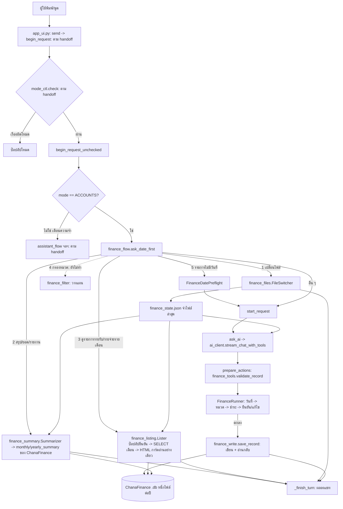

# Handoff v26 — AI เลขาส่วนตัว (Pythonista 3 / iPhone) — ดูรายการรายรับ/รายจ่ายรายเดือนใช้ได้แล้ว, ถัดไปคือกรองตามหมวด
วันที่ 16 ต.ค. 2026 — ต่อจาก handoff_v25.md (ภาพรวม/ข้อตกลง/สคีมา ChanaFinance อยู่ใน v18, Reminder ดู v14/v23, เปลี่ยนไฟล์/สรุปยอดดู v25)
ผู้ใช้: Chana — ตอบไทย กระชับ ทดสอบบน iPhone เอง **เครดิตใกล้หมด ทำทีละเรื่อง หยุดรอผู้ใช้ทุกขั้น**

## 1. กติกาทำงาน (ยืนยันซ้ำ)
- ยืนยันความเข้าใจก่อนเขียนโค้ด แก้เฉพาะจุดที่จำเป็น ไม่เดา
- ส่งไฟล์ฉบับเต็ม บอกว่าแก้ตรงไหน **บอกให้วางไฟล์ครบทุกไฟล์ที่ส่ง** แล้วปิด Pythonista สนิทก่อนเปิดใหม่
- `app_ui.py` / `assistant_flow.py` ยาวมากแล้ว ห้ามเพิ่ม: งานโหมดบัญชีแยกเป็น `finance_*.py`; ก่อนแก้ไฟล์เดิมต้องมีไฟล์ล่าสุดจากผู้ใช้ (ไม่ใช้สำเนาเก่า)
- callback เป็น bound method + `ui.delay(เมธอด, 0.3)`; ห้าม closure/lambda; ป๊อปอัปปิดตัวเองก่อนเรียก callback; เก็บ view ที่เปิดแล้วไว้ใน list ระดับโมดูล
- ไม่ส่งชุดทดสอบให้ผู้ใช้เว้นแต่ขอ; ผู้ช่วยไม่ได้ทดสอบบน iPhone จริง ต้องบอกตรง ๆ; **ห้ามแก้ไฟล์ใน ChanaFinance**
- ทดสอบการเขียนฐานข้อมูลกับสำเนา .db เท่านั้น (ขั้นนี้อ่านอย่างเดียว)

## 2. สถานะ
- Reminder: พักไว้ (พอใจ); บันทึก/แก้ไขรายรับรายจ่าย, เปลี่ยนไฟล์, สรุปยอดรายเดือน/รายปี: ใช้ได้ (v23/v25)
- **ใหม่: ดูรายการรายรับ/รายจ่ายของเดือน — ผู้ใช้ทดสอบบนเครื่องแล้ว "ใช้ได้ตามที่ตั้งใจไว้แล้ว"** (ผู้ใช้ไม่ได้รายงานแยกทุกกรณีทดสอบ)
- ถัดไป: **กรองตามหมวด** (ข้อ 5) ยังไม่เริ่มเขียนโค้ด รอผู้ใช้ตอบคำถามออกแบบ
- เฟส 3 (หลักทรัพย์): เลื่อนไว้ ยังไม่เริ่ม; งานแก้ AI แปลคำสั่งรายรับ/รายจ่ายผิดทีละกรณี: ยังไม่ได้รับตัวอย่างจริง

## 3. ไฟล์ที่เพิ่ม/แก้ในรอบนี้ (ผู้ใช้วางแล้ว)
- `finance_listing.py` (ใหม่) — หน้ารายการแบบการ์ดอ่านอย่างเดียว เขียนใหม่ในไฟล์นี้เอง **ไม่เรียกโค้ด ChanaFinance** (`data_viewer.py` ที่ติดตั้งจริงเป็นหน้าการ์ดพร้อมปุ่ม แก้ไข/ลบ/เพิ่ม ซึ่งผู้ช่วยไม่เคยเห็นฉบับจริง ผู้ใช้ไม่ต้องการปุ่มพวกนี้)
- `finance_flow.py` (แก้) — `import finance_listing` และใน `ask_date_first` เพิ่มตรวจ `finance_listing.parse_request(text)` ต่อจากสรุปยอด ก่อนตัวตรวจ "รายการรับ/จ่ายไม่มีวันที่"
- `app_ui.py` ไม่ได้แก้

## 4. พฤติกรรม `finance_listing.py`
- `parse_request(text, today)` -> None หรือ `{'kind':'income'|'expense','year','month'}`: ข้อความ ≤60 ตัวอักษร; **ต้องมี "รายรับ" หรือ "รายจ่าย" อย่างใดอย่างหนึ่ง** (มีทั้งสองหรือไม่มี = ไม่จับ) + คำขอดู (ดู/แสดง/รายการ/รายละเอียด/มีอะไร/เป็นอย่างไร/เป็นยังไง/บอก); ไม่จับถ้ามี สรุป/ยอด/รายงาน/รายปี/ทั้งปี/ประจำปี/ทั้งไฟล์ หรือมี "บาท"
- เดือน: เดือนนี้ / เดือนที่แล้ว(ก่อน/ที่ผ่านมา) / ชื่อเดือนเต็มหรือย่อ / "เดือน 9" / "9/2569"; **ไม่บอกเดือน = เดือนปัจจุบัน; ไม่บอกปี = ปีปัจจุบัน**; รับ พ.ศ. (≥2400 ลบ 543) และเลขไทย; เดือนที่แล้วตอนมกราคม = ธันวาคมปีก่อน
- ลำดับ: ป๊อปอัปยืนยัน (ChoiceOverlay ปุ่ม "แสดงรายการ" + ยกเลิก, ข้อความเดือน ค.ศ.+พ.ศ.) -> `fdb.check_schema` (ล็อก/โครงสร้างไม่ครบ แจ้ง ไม่แสดง) -> `fetch_month` (SELECT กรอง `year`/`month` เหมือนหน้าสรุปยอด; ชื่อรายการใช้ `detail_text` ถ้าว่างใช้ชื่อจาก `detail_master`) -> ไม่มีรายการ: แจ้งแชท "ไม่มีรายการ…เดือน… ในไฟล์ …" / มี: หน้าการ์ดเต็มจอ (พื้นมืด, วันที่ + ป้ายหมวดน้ำเงิน + ยอดเขียว/แดง, ชื่อรายการ, หมายเหตุเล็กสีเทา, หัว "ทั้งหมด N รายการ" + "รวม X บาท" โค้ดบวกเอง ไม่มีปุ่มใด ๆ) แล้วสรุปสั้น ๆ ลงแชท
- โครงเดียวกับ `finance_summary.Summarizer` (`host._live`, `host._finish_turn(msg,'ok',tool=True)`, เก็บ runner ที่ `host._listing_runner`) — API ที่ใช้ซ้ำได้สำหรับกรอง: `fetch_month`, `total_amount`, `build_html`, `month_title`, `_parse_month_year`, `kind_text`

## 5. ขั้นถัดไป: กรองตามหมวด (ผู้ใช้ตกลงแนวทางแล้ว ยังไม่ได้ตอบรายละเอียดข้างล่าง)
ตัวอย่างคำพูดของผู้ใช้: "เดือนนี้ได้รับปันผลมาเท่าไหร่แล้ว ลองแสดงรายละเอียดให้ดูด้วย", "เดือนนี้เสียเงินค่าอาหารไปเท่าไหร่ ช่วยแจกแจงที" (ไม่มีคำว่า รายรับ/รายจ่าย ในประโยค จึงต้องตรวจจากชื่อหมวดแทน)
ต้องการ: แสดงรายการเฉพาะหมวดนั้นของเดือน (ไม่บอกเดือน = เดือนปัจจุบัน) + ยอดรวมที่โค้ดบวก (ไม่ให้ AI บวกเลข) หน้าตาเหมือนหน้าการ์ดเดิม อ่านอย่างเดียว มีป๊อปอัปยืนยันเดือน/ปีก่อนแสดง
**คำถามออกแบบที่ผู้ช่วยถามค้างไว้ (ตอบแล้วเริ่มเขียนได้):**
1. จับหมวดอย่างไร — เสนอ: **โค้ดล้วน ไม่เรียก AI** เทียบคำในประโยคกับชื่อหมวดจริงในไฟล์ (เช่น "ปันผล" ตรงกับ "เงินปันผลจากกองทุน" และ "เงินปันผลจากหุ้น"; "ค่าอาหาร" ตรงกับ "อาหาร") ไม่สร้างหมวดเอง
2. ถ้าตรงหลายหมวด — เสนอ: แสดงรวมกันในหน้าเดียว มียอดรวมแยกต่อหมวดและยอดรวมทั้งหมด (ทางเลือก: ขึ้นรายการให้เลือกหมวดก่อน)
3. กรองเฉพาะ "หมวด" หรือรวมค้นจากชื่อรายการ (detail) ด้วย
4. ตัดสินว่าเป็นรายรับหรือรายจ่ายจากชื่อหมวดที่ตรง (ถ้าชื่อหมวดซ้ำกันทั้งสองฝั่งต้องกำหนดวิธี)
ข้อควรระวัง: ตัวตรวจต้องไม่แย่งคำสั่งบันทึกรายการ (ประโยคมี "บาท"/ตัวเลขจำนวนเงิน) และไม่แย่งสรุปยอด/ดูรายการเดิม; ลำดับตรวจใน `ask_date_first`: เปลี่ยนไฟล์ -> สรุปยอด -> ดูรายการ -> (ใหม่) กรองหมวด -> ตัวตรวจรายการไม่มีวันที่

## 6. งานค้างอื่น
"บ่ายโมง" ไม่มีเลขในประโยคปลุก; คำตอบสั้นหลัง ask-back ในประโยครวม; ปุ่ม "เพิ่มหมวดใหม่"; คืนค่า x-error ใน reminders_tool.py; ลบ debug log เมื่อเสถียร; Phase 3 หลักทรัพย์; AI แปลคำสั่งรายรับ/รายจ่ายผิด (รอตัวอย่าง)

## 7. ข้อมูลของผู้ใช้ (จาก v18)
ไฟล์ `FinStartJune2026.db`; หมวดรายรับ 9: กำไรจากการขายกองทุน, กำไรจากการขายหุ้น, ค่าเช่าบ้าน, ดอกเบี้ย, รายรับของคลินิก, เงินคืนทุนจากหุ้น, เงินปันผลจากกองทุน, เงินปันผลจากหุ้น, เบี้ยผู้สูงอายุ; หมวดรายจ่าย 12: ของใช้ในบ้าน, ค่าน้ำ ค่าไฟฟ้า ค่าอินเตอร์เน็ต, ค่าน้ำมัน, ค่ายา ค่ารักษาพยาบาล, ค่าอุปกรณ์ช่าง และทำสวน, ค่าใช้จ่ายท่องเที่ยว, ค่าใช้จ่ายส่วนตัว, ทำบุญ, ภาษี, รายจ่ายของคลินิก, อาหาร, อื่น ๆ (ข้อมูลล่าสุดมีรายการถึง 20 ต.ค. 2026 ในไฟล์)

## 8. แชทใหม่ให้ผู้ใช้แนบ
handoff_v26.md, handoff_v25.md (และ v23/v18 ถ้าต้องการรายละเอียด), `finance_listing.py`, `finance_flow.py`, `finance_summary.py`, `finance_db.py` (ต้องใช้ดูรูปแบบ `read_lists`), `finance_tools.py`

## 9. แผนภาพการไหลของข้อมูล (อัปเดตจากไฟล์ที่เห็นจริง: finance_flow, finance_summary, finance_listing; ส่วนอื่นตาม handoff)

## 10. Prompt สำหรับสร้าง/ปรับแผนภาพใน handoff รุ่นถัดไป
> วิเคราะห์ไฟล์รุ่นล่าสุดของโปรเจกต์ `secretary_Ai` ที่ผู้ใช้ส่งหรือยืนยันว่าใช้งานอยู่ แล้วสร้างหรือปรับแผนภาพภาพรวมระบบให้อ่านง่าย แสดงส่วนประกอบหลัก ความสัมพันธ์ และลำดับข้อมูลตั้งแต่ผู้ใช้เริ่มส่งคำสั่งจนได้รับผลลัพธ์ แยกเส้นทางเตือนความจำและรายรับรายจ่ายให้ชัด ใช้ Mermaid ใน handoff หากเหมาะสม ตรวจชื่อโมดูลและจุดเชื่อมต่อจากโค้ดจริง อย่านำชื่อไฟล์จาก handoff เก่ามายืนยันแทนหลักฐาน หากไม่มีข้อมูลชัดเจนให้เขียน "ไม่ทราบ" แทนการคาดเดา และคงทั้งแผนภาพกับ prompt นี้ไว้ใน handoff รุ่นถัดไป
